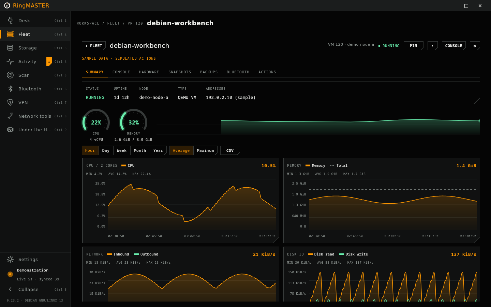
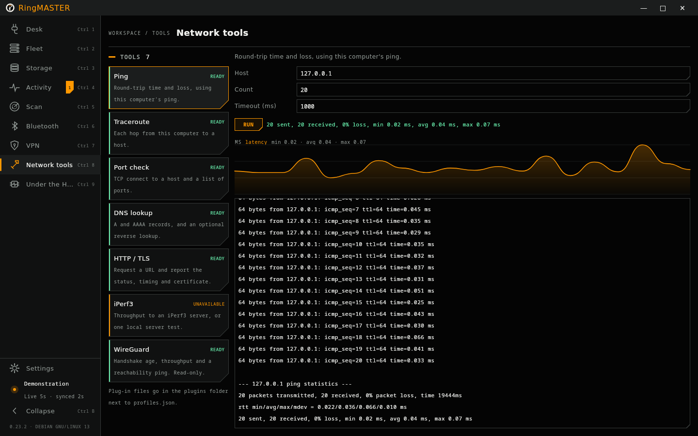
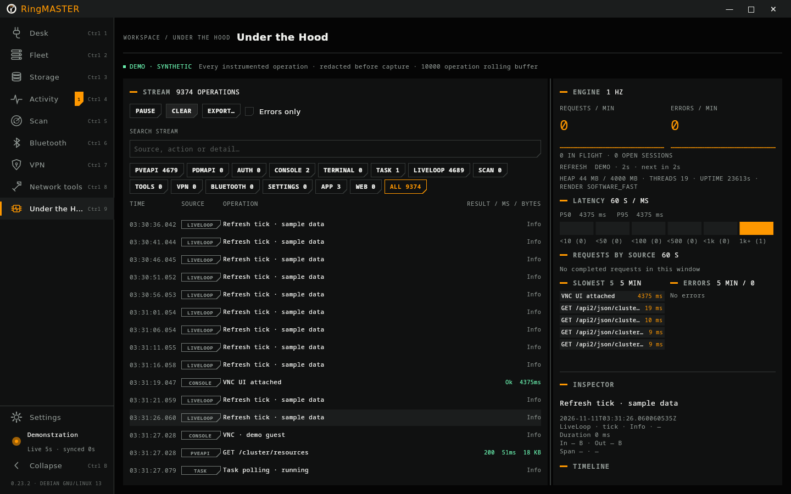

# RingMASTER

A desktop client for **Proxmox VE** and **Proxmox Datacenter Manager**, for **Windows** and **Linux** (Debian 13, Ubuntu 26.04, Fedora 45 and Arch Linux).

<p align="center"></p>

Your nodes, guests, consoles and tasks in one native window, with live charts. It asks before it changes anything, and it reports a change as done only when Proxmox says it finished.


<sub>All pictures use the built-in demo mode or invented sample data.</sub>

## Download

Get the latest version from the [Releases page](https://github.com/primary-null/RingMASTER/releases/latest).

| System | File |
|---|---|
| Windows 11, 64-bit | `RingMASTER-<version>.msi` |
| Debian 13 (trixie), amd64 | `ringmaster-<version>-debian-13-amd64.deb` |
| Ubuntu 26.04 LTS, amd64 | `ringmaster-<version>-ubuntu-26.04-amd64.deb` |
| Fedora 45, x86_64 | `ringmaster-<version>-fedora-45-x86_64.rpm` |
| Arch Linux, x86_64 | `ringmaster-<version>-arch-x86_64.pkg.tar.zst` |

Every package includes its own Java runtime, so there is nothing else to install. Windows 10 may work but is not tested. When a new version is out, RingMASTER can tell you (Settings > Updates) and open this page. Install the new package the same way.

### Windows

1. Download the `.msi` and, to check it, `SHA256SUMS` (see [Checking a download](#checking-a-download)).
2. Run the `.msi`. It installs for your Windows account only, without an administrator prompt, and adds RingMASTER to the Start menu.
3. The installer is not code-signed yet, so Windows SmartScreen may show "Windows protected your PC". Choose **More info**, then **Run anyway**. Your browser may also ask whether to keep the file.

A newer `.msi` upgrades the installed version in place. To remove RingMASTER, use Settings > Apps > Installed apps.

### Debian and Ubuntu

Download the file for your distribution and install it with apt, which also installs the libraries it needs:

```sh
sudo apt install ./ringmaster-<version>-debian-13-amd64.deb       # Debian 13
sudo apt install ./ringmaster-<version>-ubuntu-26.04-amd64.deb    # Ubuntu 26.04
```

Each package is built on its own distribution, because the two name some libraries differently. RingMASTER appears in the application menu under System, or run `/opt/ringmaster/bin/ringmaster`. Remove it with `sudo apt remove ringmaster`.

Optional: `virt-viewer` (SPICE consoles), BlueZ (Bluetooth scans), `iperf3` (iPerf3 tests), and the Tailscale or WireGuard tools (VPN page).

### Fedora 45

```sh
sudo dnf install ./ringmaster-<version>-fedora-45-x86_64.rpm
```

The package is not GPG-signed, so check it against `SHA256SUMS` first (see [Checking a download](#checking-a-download)). This is for Fedora Workstation or Server 45; rpm-ostree systems such as Silverblue are not supported. RingMASTER appears under System, or run `/opt/ringmaster/bin/ringmaster`. Remove it with `sudo dnf remove ringmaster`. GNOME on Wayland has not been checked yet; the window runs through XWayland.

Optional: `virt-viewer`, `bluez`, `iperf3`, `tailscale`, `wireguard-tools`.

### Arch Linux

```sh
sudo pacman -U ./ringmaster-<version>-arch-x86_64.pkg.tar.zst
```

RingMASTER appears under System, or run `ringmaster`. Remove it with `sudo pacman -R ringmaster`. Arch is a rolling distribution: if RingMASTER stops starting after a system update, a library it uses has probably changed. Install the newest release, or build the package yourself (see [Building from source](#building-from-source)). The package is for Arch Linux itself; derivatives such as Manjaro are not supported, and the update check does not offer them a package.

Optional: `virt-viewer`, `bluez`, `bluez-utils`, `gtk3` (file dialogs), `iperf3`, `tailscale`, `wireguard-tools`.

### Checking a download

Each release lists the SHA-256 of every file in `SHA256SUMS`.

```powershell
# Windows (PowerShell): compare the result with the line in SHA256SUMS
Get-FileHash .\RingMASTER-<version>.msi -Algorithm SHA256
```

```sh
# Linux: checks every file you downloaded
sha256sum -c SHA256SUMS --ignore-missing
```

Release files are built by GitHub Actions from the tagged source, never on a personal computer, and GitHub keeps a signed record of each build. With the [GitHub CLI](https://cli.github.com/) you can check that a file came from this repository's workflow:

```sh
gh attestation verify RingMASTER-<version>.msi --repo primary-null/RingMASTER
```

The same command works for every release file.

## What it does

**Connect**
- Saved connections to Proxmox VE and Proxmox Datacenter Manager, with an API token or a password, including TOTP and recovery codes for two-factor accounts.
- Secrets are never written to disk by RingMASTER: each connection asks for its secret when it opens.
- Remember on this computer, if you choose it for a saved connection: your operating system's password vault keeps the secret (Windows Credential Manager, or the Secret Service on Linux, such as GNOME Keyring or KeePassXC), and only after that sign-in has worked. It is off until you tick it, and there is no file fallback: with no vault you type the secret as before. Forget, changing the server or user, deleting the connection, or Clear everything removes it. Programs you run under the same account can read what the vault holds.
- Quick sign-in: choosing Password fills in root@pam, and a name without a realm signs in as name@pam. Picking a saved connection puts the cursor in the password field and Enter connects. Password managers with auto-type can match the window title, which names the connection while its sign-in form is open.
- Normal TLS validation, or a SHA-256 certificate pin you enter. There is no trust-on-first-use and no switch to ignore certificate errors.
- Up to six connections open side by side, each with its own live data, tasks and secret.
- A demo mode with clearly labelled sample data, to look around without a server.

**Fleet**
- Guests grouped by node (or by PDM remote, then node), with search, filters, live CPU, memory, network and disk, and sparklines. Refreshes every 5 s, 10 s, 30 s or 2 min, pauses while minimised and backs off on errors.
- History charts for nodes and guests, from an hour to a year: drag to zoom, a shared crosshair, CSV export.
- Hover any live chart or gauge to read the value and the time. Click it to open it large over the page, with live samples or server history from an hour to a year; Esc or a click outside closes it.
- Guest pages: summary, hardware, snapshots (create with RAM, roll back, delete), backups, Bluetooth, console and actions.
- Power actions (start, shut down, reboot, stop, reset, suspend, resume). One confirmation names the server, node, guest and action, and the task is followed to its final status.
- Node tools: services, the system log with follow, and available package updates (read-only). A storage page with usage and contents.
- Permissions: what the signed-in account may do, feature by feature, and which privilege each needs.
- Pins: keep a guest, one of its tabs, or a web page it serves in the sidebar, with a live dot for the guest's state.
- Tags show state at a glance: template, HA, lock, protected backup, unplugged network card, firewall, shared storage.


*A guest's summary and history charts, on Debian 13.*

**Consoles**
- In-app VNC console for VMs, and in-app terminals for containers, nodes and serial ports.
- A guest list beside the console, with each guest's last screen, to click through consoles; Ctrl+Alt+PageUp and Ctrl+Alt+PageDown move through it. The keyboard-captured note fades after a moment and a toolbar chip shows where keys go.
- Immersive console: Ctrl+Alt+Enter or F11 fills the screen with the guest and hides the rest of the app; the console bar returns when the pointer rests at the top edge.
- A console you leave stays connected, paused, for a keep time you choose (Off to 1 hour, 10 minutes by default; at most 4 per connection). Switching back shows the live picture at once, without reconnecting.
- SPICE through remote-viewer for VMs with a SPICE display.

**Activity**
- The cluster's tasks with outcome counts, and a live task log you can follow, copy and save. A task that ends with warnings counts as done and is marked amber.


**Network and devices**
- A scan of your private networks for Proxmox VE, Backup Server and Datacenter Manager, Pi-hole, AdGuard Home, Home Assistant and other web services. It sends no credentials. Certificates are shown for you to compare, never trusted automatically.
- Network tools: ping, traceroute, port check, DNS, HTTP/TLS, iPerf3 and WireGuard, plus [your own tools](docs/plugins/README.md) described in small JSON files.
- VPN: Tailscale and WireGuard status, up and down, exit node, and WireGuard import.
- Bluetooth: a live scan on this computer (Windows, or BlueZ on Linux) and inside a VM through the guest agent.



*Network tools on Debian 13.*

**The app**
- Its own dark window frame, which on Windows snaps like any other window (Snap Layouts, screen edges, Win+Arrow); Light, Dark and Pitch Black themes (Pitch Black is true black for OLED screens), which crossfade when you switch; custom backgrounds, an interface size for each display, and Reduce motion (which follows the operating system unless you choose).
- Under the Hood: a live trace of every API call, socket, process, refresh and task poll, with latency, counts per source and the slowest and failed operations. Request bodies and secrets are never recorded.
- Browser mode: started with `--web`, RingMASTER serves itself to a browser on this computer only, unless you allow remote access. Pass `--allow-host-actions` to let the browser run tools that act on the server host (JSON plug-ins, iperf's server and custom-path modes, VPN changes); without it the browser stays read-only for those. Pass `--public-origin` with an `https://` address when a reverse proxy or tunnel terminates TLS in front of the server. A network address needs `--allow-remote` and TLS: either `--tls-keystore` or `--public-origin`. `--bind 0.0.0.0` and `--bind ::` are accepted only with `--public-origin`. Each login link works once; press Enter in the terminal (or New link in Settings) for another. A fixed `RINGMASTER_WEB_KEY` of 24 or more characters can be reused and is never printed. Sessions end after 30 minutes idle or 12 hours, and the page has a Sign out button.
- Showcase blur for screenshots (Ctrl+Shift+B; hold Alt to peek).
- Keyboard: Ctrl 1-9 for pages, Ctrl , for settings, Ctrl B for the sidebar, Ctrl F to search, F5 to refresh.


*Under the Hood on Debian 13.*

**Not yet:** saved secrets, guest editing, backup and restore, node actions, storage changes, firewall, SDN, notifications, the scheduler, a file manager, and installing updates in place.

## Privacy and network use

- No telemetry, no analytics and no account.
- RingMASTER connects only to the servers you add, the networks you scan and the hosts you test.
- Update checks are optional and it asks before the first one. A check downloads `ringmaster-update.json` and its signature from this repository's latest release: two HTTPS requests with `User-Agent: RingMASTER/<version>` and nothing about you or your servers. It offers only releases signed with the project's key, never offers a downgrade, and opens the download page rather than installing anything. Set `RINGMASTER_DISABLE_UPDATES=1` to turn checks off entirely.
- The console does not download a browser engine. The VNC console is a client in the app. An older Chromium engine download, if one is still in the cache, is left alone.
- Settings live in `~/.config/ringmaster` (Windows: `%USERPROFILE%\.config\ringmaster`) and the cache in `~/.cache/ring-leader` (Windows: `%USERPROFILE%\.cache\ring-leader`). Settings > About > Clear everything removes saved connections, appearance, window and update preferences, configuration backups, and a leftover console browser profile if one is present. It keeps your tool plugins folder and the rest of the cache, including an older Chromium engine download. Nothing on any server is changed. The settings folder is backed up whenever the version changes (three copies kept).

## Removing RingMASTER

Uninstalling the app leaves the settings and cache folders in place. Remove `~/.config/ringmaster` and `~/.cache/ring-leader` yourself if you want them gone (on Windows, `%USERPROFILE%\.config\ringmaster` and `%USERPROFILE%\.cache\ring-leader`).

Remembered secrets live in your password vault, not in those folders. Use Clear everything (Settings, About) before uninstalling, or delete the entries named `RingMASTER/...` in the vault.

## Building from source

Requires JDK 21.

```sh
./gradlew :core:test :desktop:test    # run the tests
./gradlew :desktop:run                # run from source
./gradlew :desktop:packageMsi         # Windows installer
./gradlew :desktop:packageDeb         # .deb for the distribution you build on
./gradlew :desktop:packageRpm         # .rpm for Fedora (build on Fedora)
```

On Arch Linux, wrap the app image with the in-tree PKGBUILD:

```sh
./gradlew :desktop:createDistributable
cd packaging/arch
tar -C ../../desktop/build/compose/binaries/main/app -czf ringmaster-app.tar.gz ringmaster
cp ../../LICENSE ../../NOTICE ../../desktop/icons/ringmaster.png .
RINGMASTER_VERSION=<version> makepkg -si    # run as your user, not root; -i installs the result
```

On Windows, the Bluetooth helper in `native/ringmaster-bt` (Rust) is built when `cargo` is installed. Without it, RingMASTER uses a PowerShell scanner instead. Build each `.deb` or `.rpm` on the distribution it is for.

How releases and the signed update feed are made: [RELEASING.md](RELEASING.md).

## Licence

Apache License 2.0: see [LICENSE](LICENSE) and [NOTICE](NOTICE). Third-party licences are listed in [desktop/resources/common/THIRD-PARTY-NOTICES.txt](desktop/resources/common/THIRD-PARTY-NOTICES.txt). JediTerm is LGPL-3.0 and ships as a separate, replaceable jar.

RingMASTER is an independent project. It is not affiliated with or endorsed by Proxmox Server Solutions GmbH. Proxmox is a trademark of Proxmox Server Solutions GmbH.
