# RingMASTER

A desktop app for **Proxmox VE** and **Proxmox Datacenter Manager**, for **Windows** and **Linux** (Debian 13, Ubuntu 26.04, Fedora 45 and Arch Linux).

<p align="center"></p>

Watch every node and guest with live charts, open their consoles, and start, stop or snapshot them, without opening the Proxmox web interface. RingMASTER asks you to confirm each change, and it tells you an action worked only after the task on the server has finished.

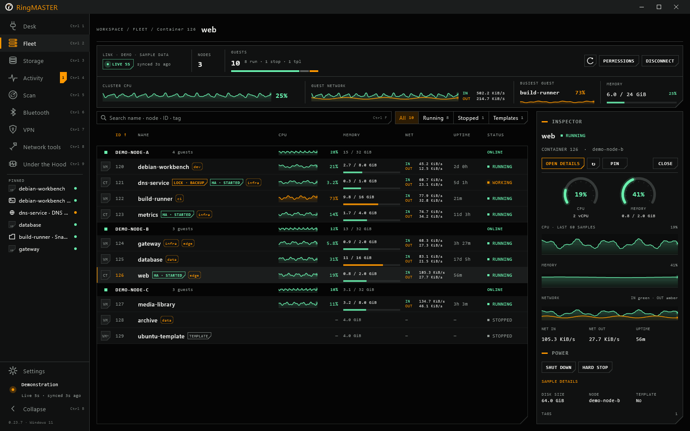

<sub>All pictures use the built-in demo mode or invented sample data.</sub>

## Download

Get the latest version from the [Releases page](https://github.com/primary-null/RingMASTER/releases/latest).

| System | File |
|---|---|
| Windows 11, 64-bit | `RingMASTER-<version>.msi` |
| Debian 13 (trixie), amd64 | `ringmaster-<version>-debian-13-amd64.deb` |
| Ubuntu 26.04 LTS, amd64 | `ringmaster-<version>-ubuntu-26.04-amd64.deb` |
| Fedora 45, x86_64 | `ringmaster-<version>-fedora-45-x86_64.rpm` |
| Arch Linux, x86_64 | `ringmaster-<version>-arch-x86_64.pkg.tar.zst` |

Every package includes its own Java runtime, so there is nothing else to install. Windows 10 may work but is not tested. To upgrade, install the newer package the same way. RingMASTER can tell you when one is out (Settings > Updates).

### Windows

1. Download the `.msi` and, to check it, `SHA256SUMS` (see [Checking a download](#checking-a-download)).
2. Run the `.msi`. It installs for your Windows account only, without an administrator prompt, and adds RingMASTER to the Start menu.
3. The installer is not code-signed yet, so Windows SmartScreen may show "Windows protected your PC". Choose **More info**, then **Run anyway**. Your browser may also ask whether to keep the file.

A newer `.msi` upgrades the installed version in place. To remove RingMASTER, use Settings > Apps > Installed apps.

### Debian and Ubuntu

Download the file for your distribution and install it with apt, which also installs the libraries it needs:

```sh
sudo apt install ./ringmaster-<version>-debian-13-amd64.deb       # Debian 13
sudo apt install ./ringmaster-<version>-ubuntu-26.04-amd64.deb    # Ubuntu 26.04
```

The two distributions name some libraries differently, so each has its own package. RingMASTER appears in the application menu under System, or run `/opt/ringmaster/bin/ringmaster`. Remove it with `sudo apt remove ringmaster`.

Optional: `virt-viewer` (SPICE consoles), BlueZ (Bluetooth scans), `iperf3` (iPerf3 tests), and the Tailscale or WireGuard tools (VPN page).

### Fedora 45

```sh
sudo dnf install ./ringmaster-<version>-fedora-45-x86_64.rpm
```

The package is for Fedora Workstation or Server 45; rpm-ostree systems such as Silverblue are not supported. It is not GPG-signed, so check it against `SHA256SUMS` before you install it (see [Checking a download](#checking-a-download)). RingMASTER appears under System, or run `/opt/ringmaster/bin/ringmaster`. Remove it with `sudo dnf remove ringmaster`. GNOME on Wayland has not been checked yet; the window runs through XWayland.

Optional: `virt-viewer`, `bluez`, `iperf3`, `tailscale`, `wireguard-tools`.

### Arch Linux

```sh
sudo pacman -U ./ringmaster-<version>-arch-x86_64.pkg.tar.zst
```

RingMASTER appears under System, or run `ringmaster`. Remove it with `sudo pacman -R ringmaster`. The package is for Arch Linux itself; derivatives such as Manjaro are not supported, and the update check does not offer them a package. Arch is a rolling distribution: if RingMASTER stops starting after a system update, a library it uses has probably changed. Install the newest release, or build the package yourself (see [Building from source](#building-from-source)).

Optional: `virt-viewer`, `bluez`, `bluez-utils`, `gtk3` (file dialogs), `iperf3`, `tailscale`, `wireguard-tools`.

### Checking a download

Each release lists the SHA-256 of every file in `SHA256SUMS`.

```powershell
# Windows (PowerShell): compare the result with the line in SHA256SUMS
Get-FileHash .\RingMASTER-<version>.msi -Algorithm SHA256
```

```sh
# Linux: checks every file you downloaded
sha256sum -c SHA256SUMS --ignore-missing
```

Release files are built by GitHub Actions from the tagged source, never on a personal computer, and GitHub keeps a signed record of each build. With the [GitHub CLI](https://cli.github.com/) you can check that a file came from this repository's workflow. The same command works for every release file:

```sh
gh attestation verify RingMASTER-<version>.msi --repo primary-null/RingMASTER
```

## What it does

**Connect**
- Saved connections to Proxmox VE and Proxmox Datacenter Manager. Sign in with an API token or a password, with a TOTP or recovery code on two-factor accounts.
- RingMASTER never writes a secret to its own files. Each connection asks for its secret when it opens, unless you tick **Remember on this computer**. Then your operating system's password vault keeps it: Windows Credential Manager, or the Secret Service on Linux (such as GNOME Keyring or KeePassXC). The secret is stored only after a sign-in with it has worked. There is no file fallback: without a vault you type the secret each time. Forget removes it, and so do deleting the connection, changing its server, user, token ID or certificate pin, and Clear everything. Other programs you run under the same account can read what the vault holds.
- Quicker sign-in: choosing Password fills in root@pam, and a user without a realm signs in as name@pam. Choosing a saved connection puts the cursor in the password field, so Enter connects. While a connection's sign-in form is open, the window title names it, so a password manager's auto-type can match it.
- Normal TLS validation, or a SHA-256 certificate pin you enter. There is no trust-on-first-use and no switch to ignore certificate errors.
- Up to six connections open at once, each with its own live data, tasks and secret.
- A demo mode with clearly labelled sample data, to look around without a server.

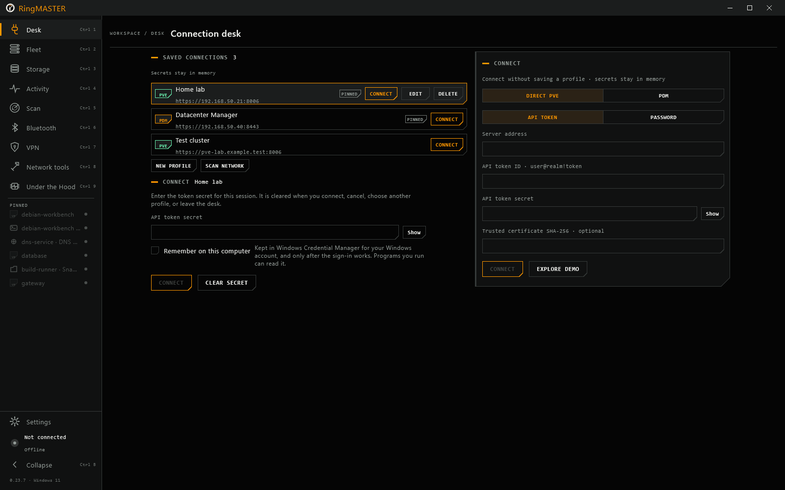

**Fleet**
- Guests grouped by node (or by PDM remote, then node), with search and filters, and live CPU, memory, network and disk with sparklines. The view refreshes every 5 s, 10 s, 30 s or 2 min, pauses while the window is minimised, and backs off after errors.
- History charts for nodes and guests, from an hour to a year, with drag to zoom, a shared crosshair and CSV export.
- Hover any live chart or gauge to read its value and time. Click it to open it large over the page, with live samples and, for nodes and guests, server history from an hour to a year. Esc or a click outside closes it.
- Guest pages: summary, hardware, snapshots (create with RAM, roll back, delete), backups, Bluetooth, console and actions.
- Power actions: start, shut down, reboot, stop, reset, suspend and resume. The confirmation names the server, node, guest and action.
- Node tools: services, the system log with follow, and available package updates (read-only). A storage page with usage and contents.
- Permissions: what the signed-in account may do, feature by feature, and which privilege each feature needs.
- Pins: keep a guest, one of its tabs, or a web page it serves in the sidebar, with a live dot for the guest's state.
- Tags mark templates, HA, locks, protected backups, unplugged network cards, firewalls and shared storage.

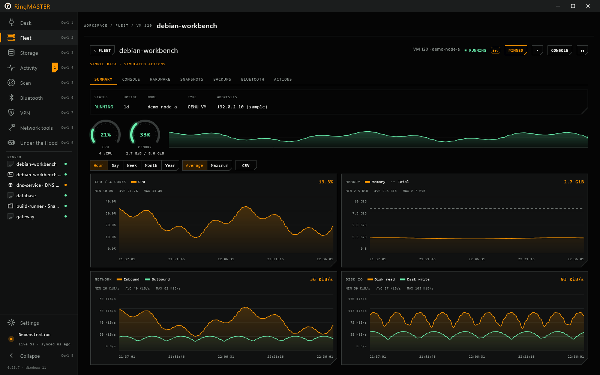

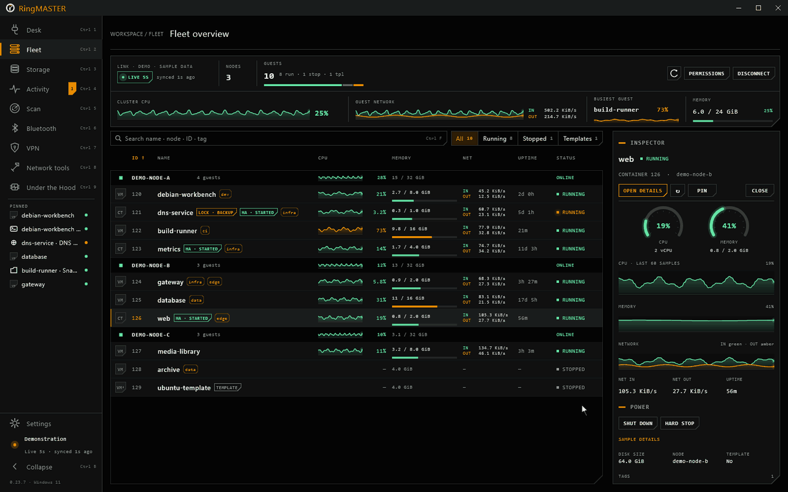

**Consoles**
- An in-app VNC console for VMs, and in-app terminals for containers, nodes and serial ports. VMs with a SPICE display open in remote-viewer.
- A list of guests beside the console, each with its last screen, so you can click from one console to the next. Ctrl+Alt+PageUp and Ctrl+Alt+PageDown do the same from the keyboard. When the console takes the keyboard, a short note says so and fades, and a toolbar chip keeps showing where your keys go.
- Immersive console: Ctrl+Alt+Enter or F11 fills the screen with the guest and hides the rest of the app. The console bar comes back when the pointer rests at the top edge.
- A console you leave stays connected, paused, for a time you choose: Off, 5, 10 or 30 minutes, or 1 hour (10 minutes by default), at most 4 per connection. Going back shows the live picture at once, without reconnecting.

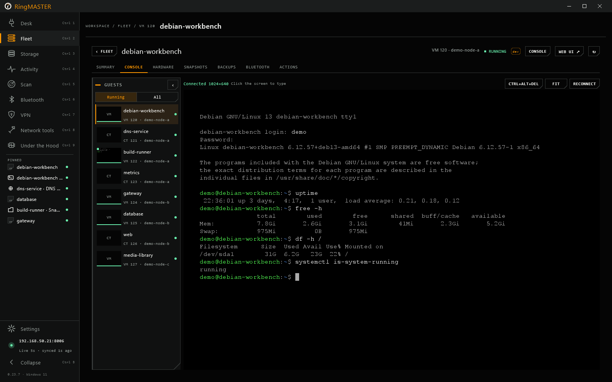

**Activity**
- The cluster's tasks with counts by outcome, and a live task log you can follow, copy and save. A task that ends with warnings counts as succeeded and is marked amber.

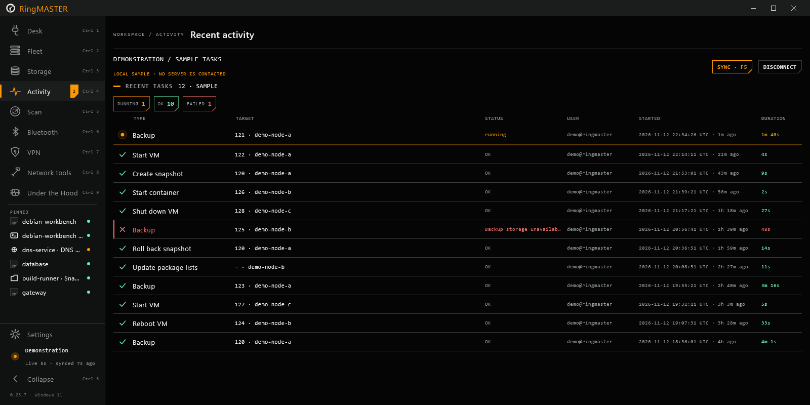

**Network and devices**
- A scan of your private networks that finds Proxmox VE, Backup Server and Datacenter Manager, Pi-hole, AdGuard Home, Home Assistant and other web services. It sends no credentials, and it shows each certificate for you to compare rather than trusting it.
- Network tools: ping, traceroute, port check, DNS, HTTP/TLS, iPerf3 and WireGuard, plus [your own tools](docs/plugins/README.md) described in small JSON files.
- VPN: Tailscale and WireGuard status, up and down, exit node, and WireGuard import.
- Bluetooth: a live scan on this computer (Windows, or BlueZ on Linux) and inside a VM through the guest agent.

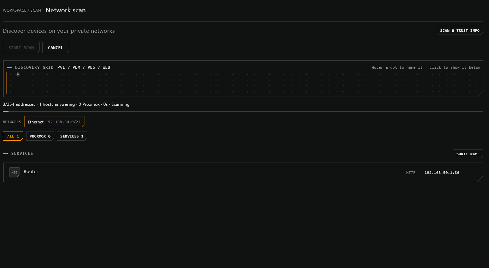

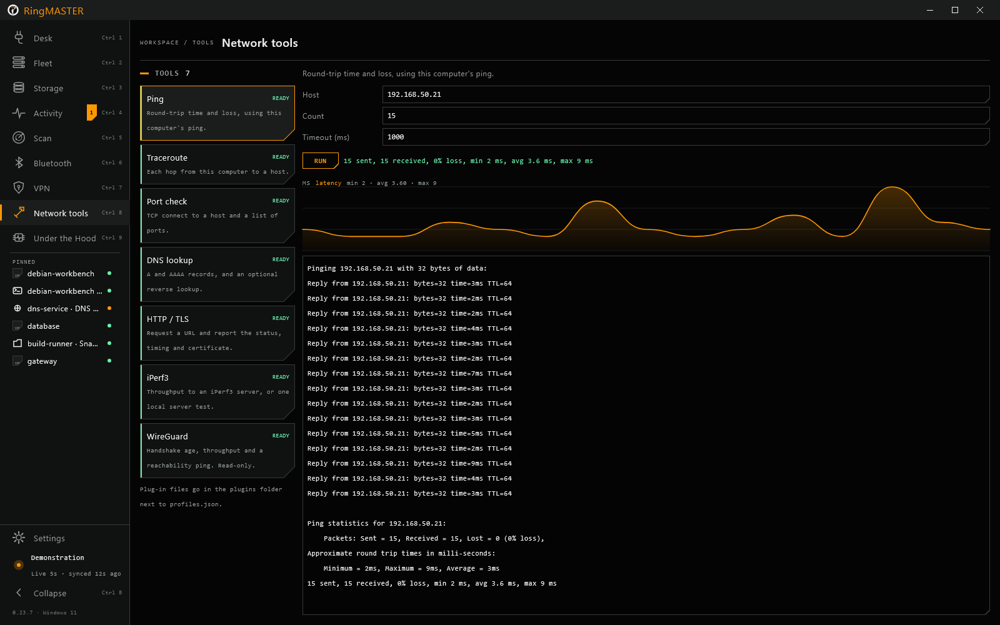

**The app**
- Its own window frame in place of the system title bar, in the colours of the theme you choose. On Windows it snaps like any other window: Snap Layouts, screen edges and Win+Arrow.
- Dark, Pitch Black (true black for OLED screens) and Light themes, or follow the system. Switching crossfades the whole window. Custom backgrounds, an interface size for each display, and Reduce motion, which follows the operating system unless you set it.
- Under the Hood: a live trace of every API call, socket, process, refresh and task poll, with latency, counts per source and the slowest and failed operations. Request bodies and secrets are never recorded.
- Browser mode: start RingMASTER with `--web` and it serves itself to a browser on this computer. Each login link works once; press Enter in the terminal (or New link in Settings) for another. A fixed `RINGMASTER_WEB_KEY` of 24 or more characters can be reused and is never printed. Sessions end after 30 minutes idle or 12 hours, and the page has a Sign out button.
  - To serve a network address, add `--allow-remote` and TLS: either `--tls-keystore`, or `--public-origin` with the `https://` address of a reverse proxy or tunnel that terminates TLS in front of RingMASTER. `--bind 0.0.0.0` and `--bind ::` are accepted only with `--public-origin`.
  - Tools that act on the computer running RingMASTER (JSON plug-ins, iperf's server and custom-path modes, VPN changes) stay read-only in the browser unless you pass `--allow-host-actions`.
- Showcase blur for screenshots (Ctrl+Shift+B; hold Alt to peek).
- Keyboard: Ctrl 1-9 for pages, Ctrl , for settings, Ctrl B for the sidebar, Ctrl F to search the fleet, F5 to refresh, and Ctrl +, Ctrl - and Ctrl 0 for the interface size.

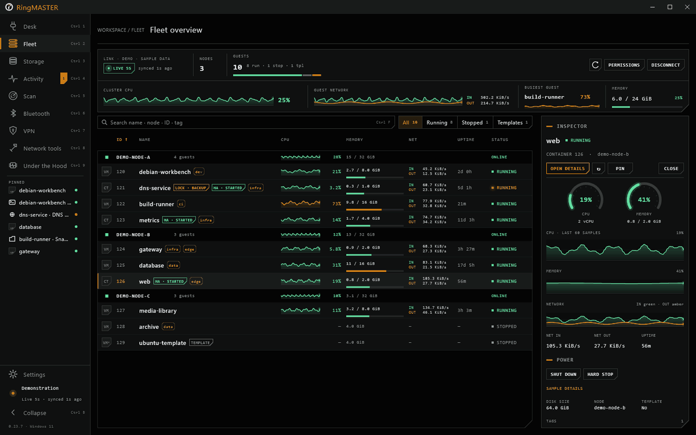

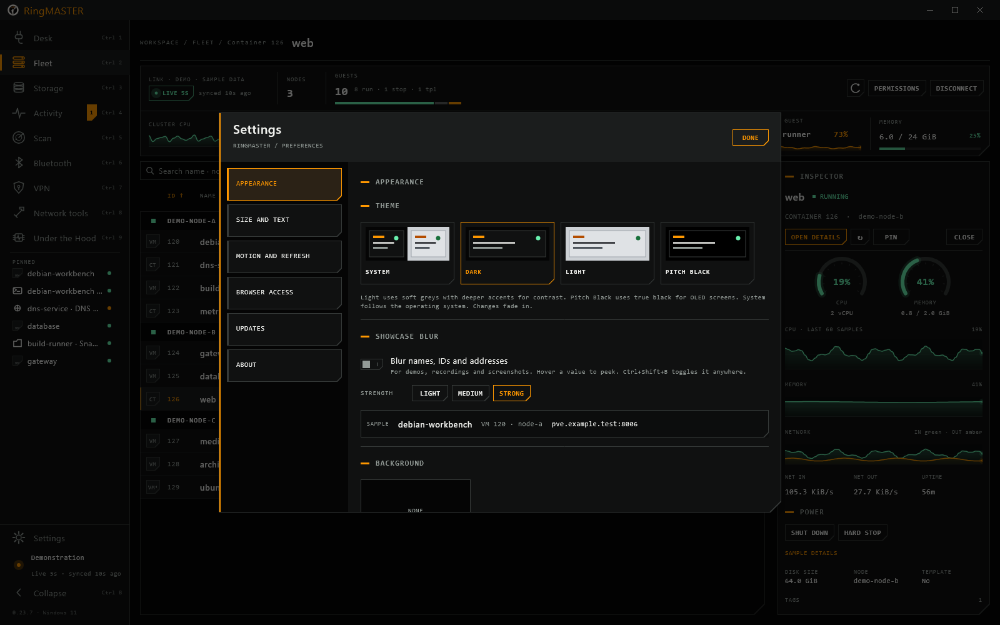

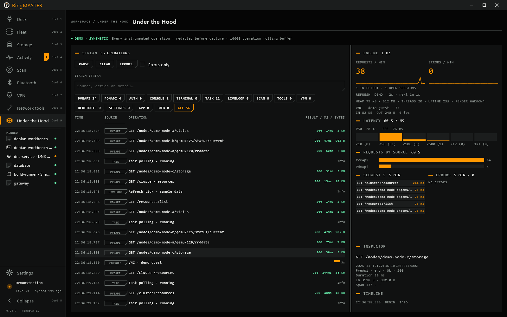

**Not yet:** guest editing, creating or restoring backups, node actions, storage changes, firewall, SDN, notifications, the scheduler, a file manager, and installing updates in place.

## Privacy and network use

- No telemetry, no analytics and no account.
- RingMASTER connects only to the servers you add, the networks you scan and the hosts you test.
- Update checks are optional, and RingMASTER asks before the first one. A check downloads `ringmaster-update.json` and its signature from this repository's latest release: two HTTPS requests with `User-Agent: RingMASTER/<version>` and nothing about you or your servers. It offers only releases signed with the project's key, never offers a downgrade, and opens the download page rather than installing anything. Set `RINGMASTER_DISABLE_UPDATES=1` to turn checks off entirely.
- The consoles are part of the app, so RingMASTER does not download a browser engine. An older Chromium engine download, if one is still in the cache, is left alone.
- What RingMASTER keeps stays on this computer: settings and a cache in your home folder, and remembered secrets in your password vault. [Removing RingMASTER](#removing-ringmaster) says where.

## Removing RingMASTER

Uninstalling the app leaves its data in place:

- Settings: `~/.config/ringmaster` (Windows: `%USERPROFILE%\.config\ringmaster`). The folder is backed up whenever the version changes, and the three newest copies are kept.
- Cache: `~/.cache/ring-leader` (Windows: `%USERPROFILE%\.cache\ring-leader`).
- If `XDG_CONFIG_HOME` or `XDG_CACHE_HOME` is set, the matching folder is under it instead.
- Remembered secrets: in your password vault, not in those folders. Windows Credential Manager lists them as `RingMASTER/...`; in a Linux vault their labels start with `RingMASTER:`.

Before uninstalling, use Settings > About > Clear everything. It removes saved connections, remembered secrets, appearance, window, refresh and update preferences, configuration backups, and a leftover console browser profile if one is present, then RingMASTER quits. It keeps your tool plugins folder and the rest of the cache, and nothing on any server is changed. Delete the two folders yourself if you want them gone too.

## Building from source

Requires JDK 21.

```sh
./gradlew :core:test :desktop:test    # run the tests
./gradlew :desktop:run                # run from source
./gradlew :desktop:packageMsi         # Windows installer
./gradlew :desktop:packageDeb         # .deb for the distribution you build on
./gradlew :desktop:packageRpm         # .rpm for Fedora (build on Fedora)
```

Build each `.deb` or `.rpm` on the distribution it is for. On Arch Linux, wrap the app image with the in-tree PKGBUILD:

```sh
./gradlew :desktop:createDistributable
cd packaging/arch
tar -C ../../desktop/build/compose/binaries/main/app -czf ringmaster-app.tar.gz ringmaster
cp ../../LICENSE ../../NOTICE ../../desktop/icons/ringmaster.png .
RINGMASTER_VERSION=<version> makepkg -si    # run as your user, not root; -i installs the result
```

On Windows, the Bluetooth helper in `native/ringmaster-bt` (Rust) is built when `cargo` is installed. Without it, RingMASTER uses a PowerShell scanner instead.

How releases and the signed update feed are made: [RELEASING.md](RELEASING.md).

## Licence

Apache License 2.0: see [LICENSE](LICENSE) and [NOTICE](NOTICE). Third-party licences are listed in [desktop/resources/common/THIRD-PARTY-NOTICES.txt](desktop/resources/common/THIRD-PARTY-NOTICES.txt). JediTerm is LGPL-3.0 and ships as a separate, replaceable jar.

RingMASTER is an independent project. It is not affiliated with or endorsed by Proxmox Server Solutions GmbH. Proxmox is a trademark of Proxmox Server Solutions GmbH.
