# RingMASTER

A desktop app for **Proxmox VE** and **Proxmox Datacenter Manager**, for **Windows** and **Linux** (Debian 13, Ubuntu 26.04, Fedora 45 and Arch Linux).

<p align="center"></p>

Watch every node and guest with live charts, open their consoles, start, stop or snapshot them, and see every Bluetooth and Wi-Fi adapter across your fleet, without opening the Proxmox web interface. RingMASTER asks you to confirm each change, and it tells you an action worked only after the task on the server has finished.

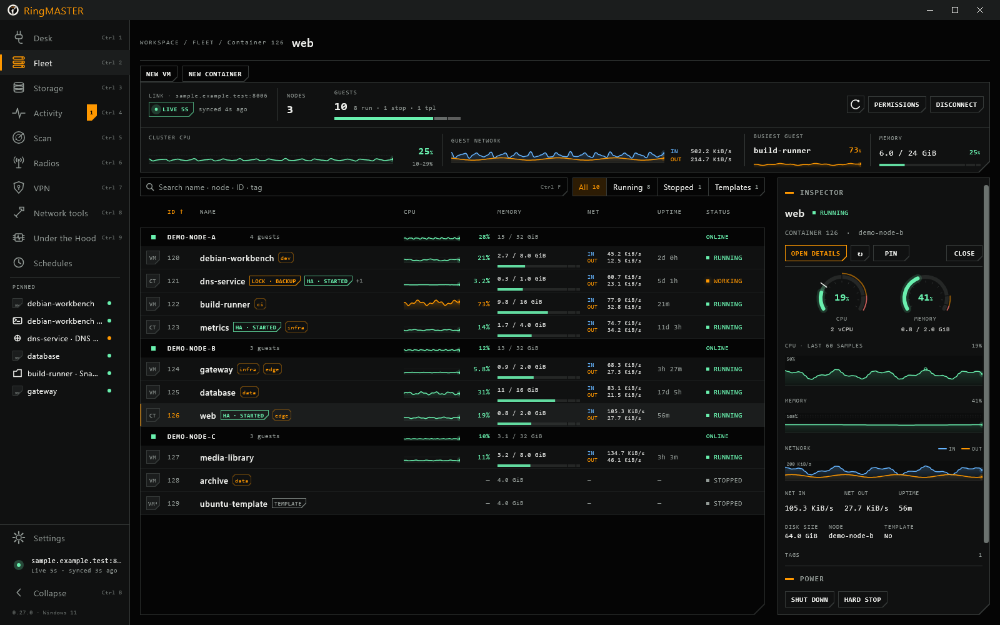

<sub>All pictures use invented sample data.</sub>

## Download

Get the latest version from the [Releases page](https://github.com/primary-null/RingMASTER/releases/latest).

| System | File |
|---|---|
| Windows 11, 64-bit | `RingMASTER-<version>.msi` |
| Debian 13 (trixie), amd64 | `ringmaster-<version>-debian-13-amd64.deb` |
| Ubuntu 26.04 LTS, amd64 | `ringmaster-<version>-ubuntu-26.04-amd64.deb` |
| Fedora 45, x86_64 | `ringmaster-<version>-fedora-45-x86_64.rpm` |
| Arch Linux, x86_64 | `ringmaster-<version>-arch-x86_64.pkg.tar.zst` |

Every package includes its own Java runtime, so there is nothing else to install. Windows 10 may work but is not tested. To upgrade, install the newer package the same way. RingMASTER can tell you when one is out (Settings > Updates).

### Windows

1. Download the `.msi` and, to check it, `SHA256SUMS` (see [Checking a download](#checking-a-download)).
2. Run the `.msi`. It installs for your Windows account only, without an administrator prompt, and adds RingMASTER to the Start menu.
3. The installer is not code-signed yet, so Windows SmartScreen may show "Windows protected your PC". Choose **More info**, then **Run anyway**. Your browser may also ask whether to keep the file.

A newer `.msi` upgrades the installed version in place. To remove RingMASTER, use Settings > Apps > Installed apps.

### Debian and Ubuntu

Download the file for your distribution and install it with apt, which also installs the libraries it needs:

```sh
sudo apt install ./ringmaster-<version>-debian-13-amd64.deb       # Debian 13
sudo apt install ./ringmaster-<version>-ubuntu-26.04-amd64.deb    # Ubuntu 26.04
```

The two distributions name some libraries differently, so each has its own package. RingMASTER appears in the application menu under System, or run `/opt/ringmaster/bin/ringmaster`. Remove it with `sudo apt remove ringmaster`.

Optional: `virt-viewer` (SPICE consoles), BlueZ (Bluetooth scans), `iperf3` (iPerf3 tests), and the Tailscale or WireGuard tools (VPN page).

### Fedora 45

```sh
sudo dnf install ./ringmaster-<version>-fedora-45-x86_64.rpm
```

The package is for Fedora Workstation or Server 45; rpm-ostree systems such as Silverblue are not supported. It is not GPG-signed, so check it against `SHA256SUMS` before you install it (see [Checking a download](#checking-a-download)). RingMASTER appears under System, or run `/opt/ringmaster/bin/ringmaster`. Remove it with `sudo dnf remove ringmaster`. GNOME on Wayland has not been checked yet; the window runs through XWayland.

Optional: `virt-viewer`, `bluez`, `iperf3`, `tailscale`, `wireguard-tools`.

### Arch Linux

```sh
sudo pacman -U ./ringmaster-<version>-arch-x86_64.pkg.tar.zst
```

RingMASTER appears under System, or run `ringmaster`. Remove it with `sudo pacman -R ringmaster`. The package is for Arch Linux itself; derivatives such as Manjaro are not supported, and the update check does not offer them a package. Arch is a rolling distribution: if RingMASTER stops starting after a system update, a library it uses has probably changed. Install the newest release, or build the package yourself (see [Building from source](#building-from-source)).

Optional: `virt-viewer`, `bluez`, `bluez-utils`, `gtk3` (file dialogs), `iperf3`, `tailscale`, `wireguard-tools`.

### Checking a download

Each release lists the SHA-256 of every file in `SHA256SUMS`.

```powershell
# Windows (PowerShell): compare the result with the line in SHA256SUMS
Get-FileHash .\RingMASTER-<version>.msi -Algorithm SHA256
```

```sh
# Linux: checks every file you downloaded
sha256sum -c SHA256SUMS --ignore-missing
```

Release files are built by GitHub Actions from the tagged source, never on a personal computer, and GitHub keeps a signed record of each build. With the [GitHub CLI](https://cli.github.com/) you can check that a file came from this repository's workflow. The same command works for every release file:

```sh
gh attestation verify RingMASTER-<version>.msi --repo primary-null/RingMASTER
```

## What it does

**Connect**
- Saved connections to Proxmox VE and Proxmox Datacenter Manager. Sign in with an API token or a password, with a TOTP or recovery code on two-factor accounts.
- RingMASTER never writes a secret to its own files. Each connection asks for its secret when it opens, unless you tick **Remember on this computer**. Then your operating system's password vault keeps it: Windows Credential Manager, or the Secret Service on Linux (such as GNOME Keyring or KeePassXC). The secret is stored only after a sign-in with it has worked. There is no file fallback: without a vault you type the secret each time. Forget removes it, and so do deleting the connection, changing its server, user, token ID or certificate pin, and Clear everything. Other programs you run under the same account can read what the vault holds.
- Quicker sign-in: choosing Password fills in root@pam, and a user without a realm signs in as name@pam. Choosing a saved connection puts the cursor in the password field, so Enter connects. While a connection's sign-in form is open, the window title names it, so a password manager's auto-type can match it.
- Normal TLS validation, or a SHA-256 certificate pin you enter. There is no trust-on-first-use and no switch to ignore certificate errors.
- Up to six connections open at once, each with its own live data, tasks and secret.

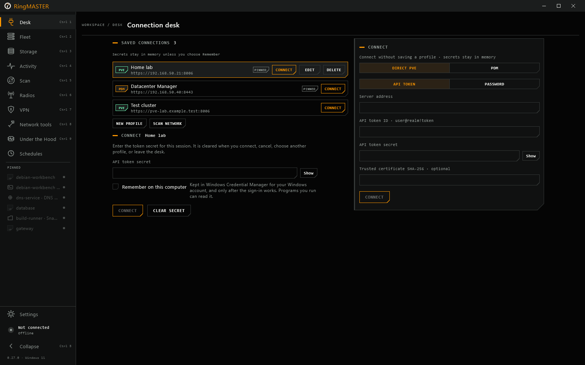

**Fleet**
- Guests grouped by node (or by PDM remote, then node), with search and filters, and live CPU, memory, network and disk with sparklines. The view refreshes every 5 s, 10 s, 30 s or 2 min, pauses while the window is minimised, and backs off after errors.
- History charts for nodes and guests, from an hour to a year, with drag to zoom, a shared crosshair and CSV export.
- Hover any live chart or gauge to read its value and time. Click it to open it large over the page, with live samples and, for nodes and guests, server history from an hour to a year. Esc or a click outside closes it.
- Guest pages: summary, hardware, snapshots (create with RAM, roll back, delete), backups, radios, console and actions.
- New VM and New container: a guided form with the node's own storages, bridges, ISO images and templates, and one confirmation that lists what will be created.
- Power actions: start, shut down, reboot, stop, reset, suspend and resume. The confirmation names the server, node, guest and action.
- Node tools: services, the system log with follow, and available package updates (read-only).
- Storage: usage and contents of every storage, and, each with its own confirmation, upload an ISO image or template, download one from a URL or the template list, remove a volume, and edit a backup's notes or protection.
- Permissions: what the signed-in account may do, feature by feature, and which privilege each feature needs.
- Pins: keep a guest, one of its tabs, or a web page it serves in the sidebar, with a live dot for the guest's state.
- Tags mark templates, HA, locks, protected backups, unplugged network cards, firewalls and shared storage.

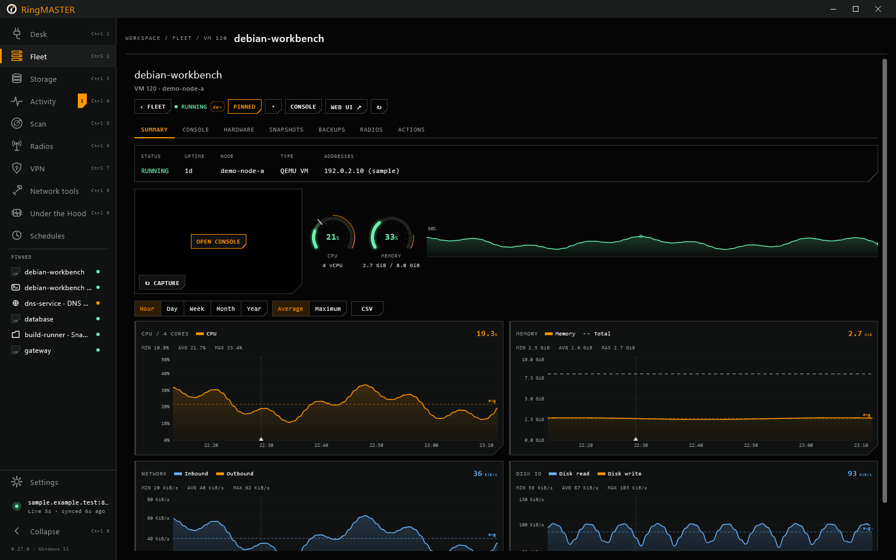

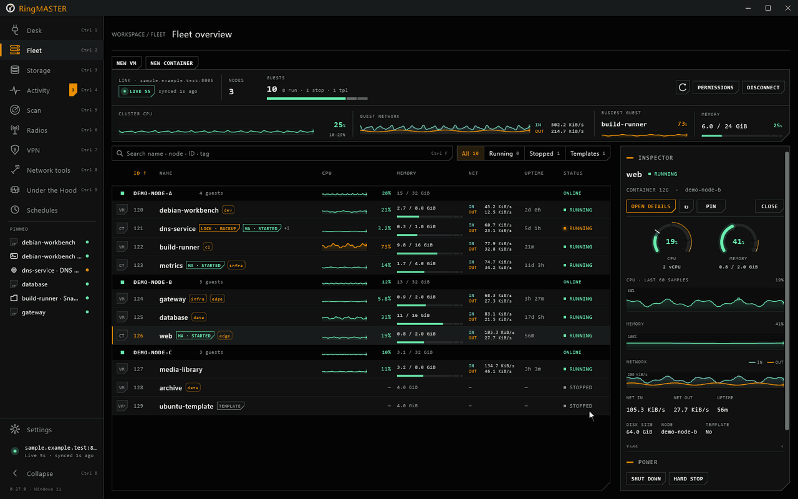

**Consoles**
- An in-app VNC console for VMs, and in-app terminals for containers, nodes and serial ports. VMs with a SPICE display open in remote-viewer.
- A list of guests beside the console, each with its last screen, so you can click from one console to the next. Ctrl+Alt+PageUp and Ctrl+Alt+PageDown do the same from the keyboard. When the console takes the keyboard, a short note says so and fades, and a toolbar chip keeps showing where your keys go.
- Immersive console: Ctrl+Alt+Enter fills the screen with the guest and also exits it, even while the console holds the keyboard. Rest the pointer at the top edge to reveal the console bar and its Exit immersive button. F11 toggles full screen, and Esc leaves it, when the console is not capturing the keyboard.
- A console you leave stays connected, paused, for a time you choose: Off, 5, 10 or 30 minutes, or 1 hour (10 minutes by default), at most 4 per connection. Going back shows the live picture at once, without reconnecting.

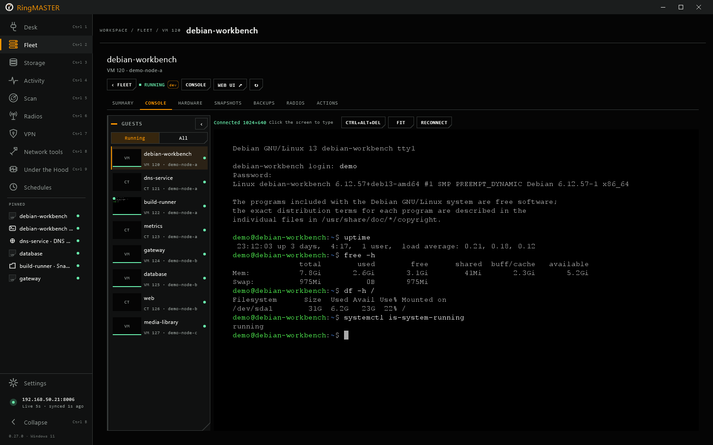

**Activity**
- The cluster's tasks with counts by outcome, and a live task log you can follow, copy and save. A task that ends with warnings counts as succeeded and is marked amber.

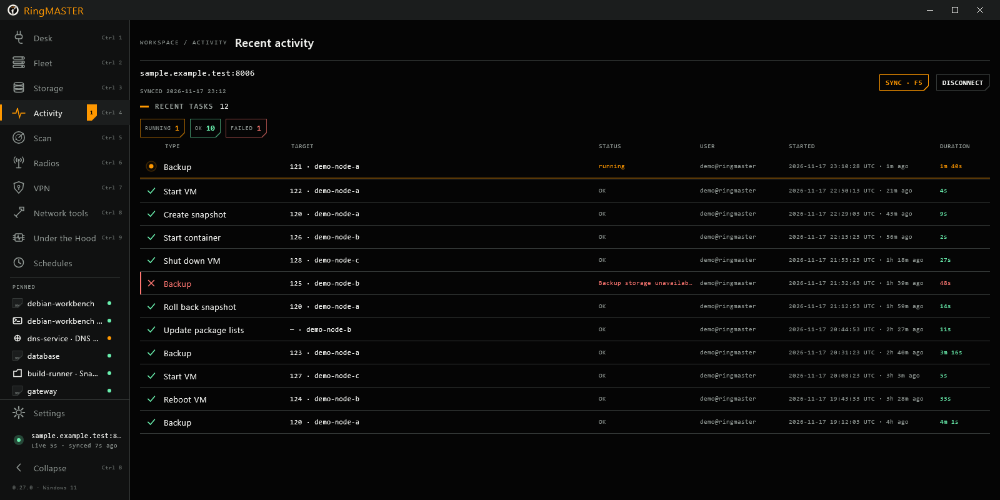

**Radios: Bluetooth and Wi-Fi**
- One map of every Bluetooth and Wi-Fi adapter: this computer's, each node's (USB and PCI), and which guest each one is given to, with how sure that match is. Lines are solid to a running guest and dashed to a stopped one.
- Four states, each drawn in its own icon, colour and word: Active, Ready, Inactive (kept for a stopped guest) and Disabled (turned off by a radio switch). They change live as guests start and stop.
- A Radios strip on Fleet, a Radios tab on each guest, and a radios section on each node.
- Wi-Fi: the networks this computer sees, with channels and signal over time, or the networks a VM sees through its own adapter. Bluetooth: a live scan on this computer or inside a VM.
- Network names and Bluetooth and Wi-Fi addresses stay hidden until you choose Show names, and never go into diagnostics. Saved Wi-Fi passwords are never read. Nothing here changes anything on a server, and a command runs inside a guest only when you click for it.
- On Windows, Wi-Fi scans need Location turned on (Settings > Privacy & security > Location). On Linux they use NetworkManager or `iw`. Listing a node's USB adapters needs an account that may list USB devices (in Proxmox VE, `Sys.Modify` on `/`).

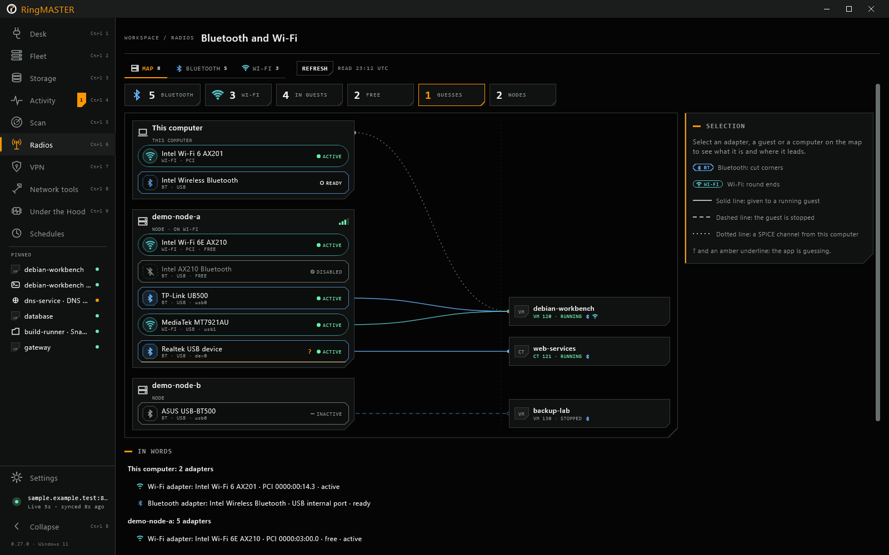

**RingMASTER Engine (optional, for Linux guests)**
- Where the QEMU guest agent cannot answer (a container, or an account without guest-agent rights), a guest's Radios tab offers to set up the RingMASTER Engine: a small program that runs inside the guest and answers RingMASTER over TLS on port 8696.
- It only reads which radios the guest has, and scans when you ask. It has no shell, runs nothing it is sent, never reads a saved Wi-Fi password, and runs as its own account without root. It answers only local networks and tailnets.
- Install it with one click through the guest agent where that is allowed, by pasting one command that fetches it from RingMASTER over a one-time link, or, for a guest with internet, from this release page, checked by its SHA-256. You pair it by comparing the certificate fingerprint the installer prints and typing its one-time pairing token. Settings > RingMASTER Engine lists the pairings and removes them.
- The Engine is built for Linux on x86_64 and aarch64 by this repository's release workflow and ships inside each RingMASTER package. Remove it from a guest with `sudo sh /usr/local/lib/ringmaster-engine/uninstall.sh`.

**Network and devices**
- A scan of your private networks that finds Proxmox VE, Backup Server and Datacenter Manager, Pi-hole, AdGuard Home, Home Assistant and other web services. It sends no credentials, and it shows each certificate for you to compare rather than trusting it.
- Network tools: ping, traceroute, port check, DNS, HTTP/TLS, iPerf3 and WireGuard, plus [your own tools](docs/plugins/README.md) described in small JSON files.
- VPN: Tailscale and WireGuard status, up and down, exit node, and WireGuard import.

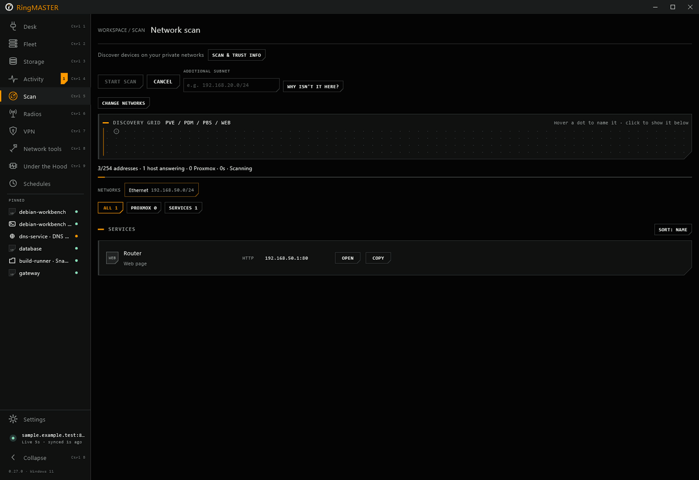

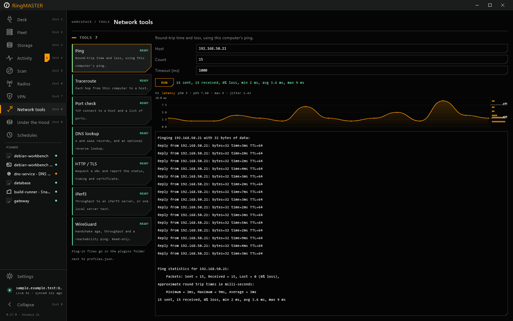

**Schedules and alerts**
- Schedules: start or shut down a guest once, daily, on weekdays or on chosen days. They run while RingMASTER is running, also when its window is closed to the notification area; a run missed by more than 15 minutes is recorded as Missed.
- Watcher: keep an eye on chosen nodes and guests across your saved connections, with notifications when one changes state or stays under heavy load, and when a task fails.

**The app**
- A theme-aware notification-area menu with shortcuts to Fleet, Activity, Notifications, Schedules, other pages and tools, Settings, update checks and About. It shows the running version and schedule status; shortcuts bring the app forward.
- Its own title bar in the colours of the theme you choose, with dragging, resizing, minimize and maximize. Native Windows Snap Layouts integration is temporarily disabled while a window-restore rendering issue is investigated.
- Dark, Pitch Black (true black for OLED screens) and Light themes, or follow the system. Switching crossfades the whole window. A High Contrast theme uses pure black or white with the strongest text and edges, and when the operating system asks for high contrast (Windows contrast themes, a Linux desktop's high-contrast theme) RingMASTER follows it, with the Windows theme's own colours; this can be turned off in Settings. Custom backgrounds, an interface size for each display, and Reduce motion, which follows the operating system unless you set it.
- Under the Hood: a live trace of every API call, socket, process, refresh and task poll, with latency, counts per source and the slowest and failed operations. Request bodies and secrets are never recorded.
- Browser mode: start RingMASTER with `--web` and it serves itself to a browser on this computer. Each login link works once; press Enter in the terminal (or New link in Settings) for another. A fixed `RINGMASTER_WEB_KEY` of 24 or more characters can be reused and is never printed. Sessions end after 30 minutes idle or 12 hours, and the page has a Sign out button.
  - To serve a network address, add `--allow-remote` and TLS: either `--tls-keystore`, or `--public-origin` with the `https://` address of a reverse proxy or tunnel that terminates TLS in front of RingMASTER. `--bind 0.0.0.0` and `--bind ::` are accepted only with `--public-origin`.
  - Tools that act on the computer running RingMASTER (JSON plug-ins, iperf's server and custom-path modes, VPN changes) stay read-only in the browser unless you pass `--allow-host-actions`. On a listener other computers can reach (a network bind or `--public-origin`), RingMASTER refuses to start with `--allow-host-actions` unless you also pass `--allow-remote-host-actions`, because every signed-in browser then runs programs on this computer.
- Showcase blur for screenshots (Ctrl+Shift+B; hold Alt to peek).
- Keyboard: Ctrl 1-9 for pages, Ctrl , for settings, Ctrl B for the sidebar, Ctrl F to search the fleet, F5 to refresh, and Ctrl +, Ctrl - and Ctrl 0 for the interface size.

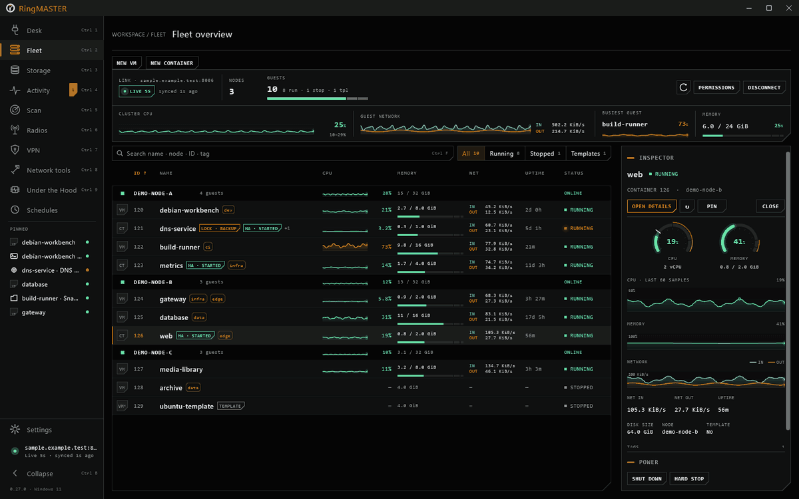

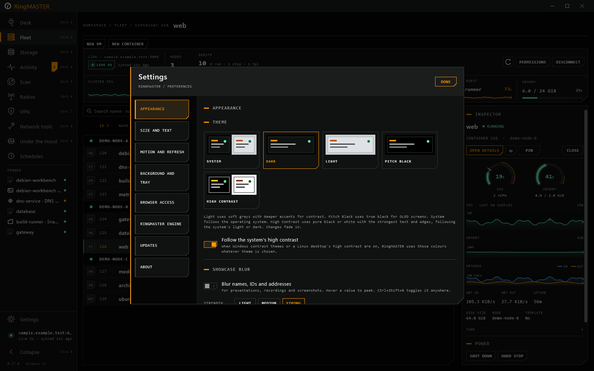

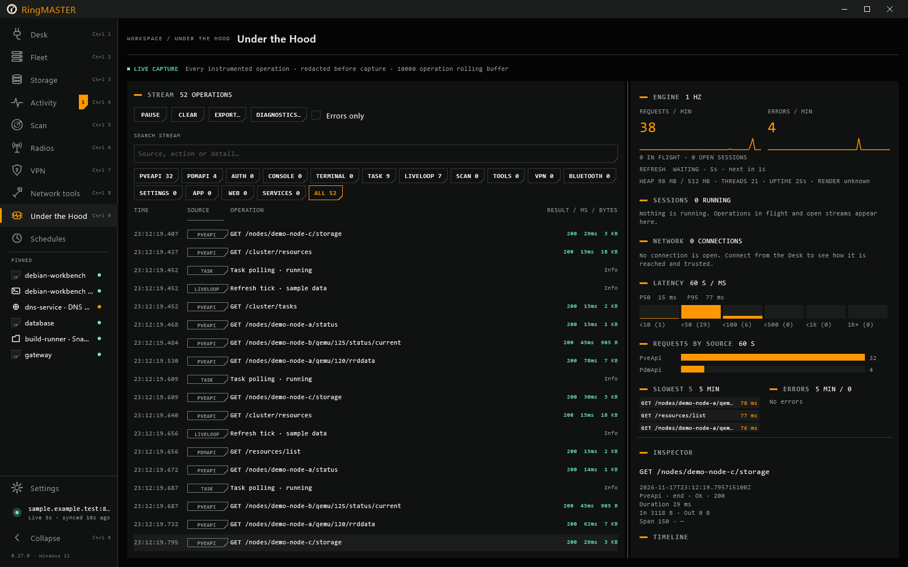

**Not yet:** guest editing, creating or restoring backups, node actions, firewall, SDN, attaching radios to guests, pairing and connecting Bluetooth devices, a file manager, and installing updates in place.

## Privacy and network use

- No telemetry, no analytics and no account.
- RingMASTER connects only to the servers you add, the networks you scan and the hosts you test.
- Update checks are optional, and RingMASTER asks before the first one. A check downloads `ringmaster-update.json` and its signature from this repository's latest release. GitHub answers with redirects, so a check contacts github.com and its release file server (release-assets.githubusercontent.com) and nowhere else; a redirect to any other host, a different port or plain HTTP ends the check. Each request is an ordinary HTTPS request with `User-Agent: RingMASTER/<version>` and nothing about you or your servers; GitHub sees normal web request details, including your IP address. It offers only releases signed with the project's key, never offers a downgrade, and opens the download page rather than installing anything. Set `RINGMASTER_DISABLE_UPDATES=1` to turn checks off entirely.
- The consoles are part of the app, so RingMASTER does not download a browser engine. An older Chromium engine download, if one is still in the cache, is left alone.
- What RingMASTER keeps stays on this computer: settings and a cache in your home folder, and remembered secrets in your password vault. [Removing RingMASTER](#removing-ringmaster) says where.

## Removing RingMASTER

Uninstalling the app leaves its data in place:

- Settings: `~/.config/ringmaster` (Windows: `%USERPROFILE%\.config\ringmaster`). The folder is backed up whenever the version changes, and the three newest copies are kept.
- Cache: `~/.cache/ring-leader` (Windows: `%USERPROFILE%\.cache\ring-leader`).
- If `XDG_CONFIG_HOME` or `XDG_CACHE_HOME` is set, the matching folder is under it instead.
- Remembered secrets: in your password vault, not in those folders. Windows Credential Manager lists them as `RingMASTER/...`; in a Linux vault their labels start with `RingMASTER:`.

Before uninstalling, use Settings > About > Clear everything. It removes saved connections, remembered secrets, appearance, window, refresh and update preferences, configuration backups, and a leftover console browser profile if one is present, then RingMASTER quits. It keeps your tool plugins folder and the rest of the cache, and nothing on any server is changed. Delete the two folders yourself if you want them gone too.

## Building from source

Requires JDK 21.

```sh
./gradlew :core:test :desktop:test    # run the tests
./gradlew :desktop:run                # run from source
./gradlew :desktop:packageMsi         # Windows installer
./gradlew :desktop:packageDeb         # .deb for the distribution you build on
./gradlew :desktop:packageRpm         # .rpm for Fedora (build on Fedora)
```

Build each `.deb` or `.rpm` on the distribution it is for. On Arch Linux, wrap the app image with the in-tree PKGBUILD:

```sh
./gradlew :desktop:createDistributable
cd packaging/arch
tar -C ../../desktop/build/compose/binaries/main/app -czf ringmaster-app.tar.gz ringmaster
cp ../../LICENSE ../../NOTICE ../../desktop/icons/ringmaster.png .
RINGMASTER_VERSION=<version> makepkg -si    # run as your user, not root; -i installs the result
```

On Windows, the Bluetooth helper in `native/ringmaster-bt` (Rust) is built when `cargo` is installed. Without it, RingMASTER uses a PowerShell scanner instead.

How releases and the signed update feed are made: [RELEASING.md](RELEASING.md).

## Licence

RingMASTER is free software under the GNU Affero General Public License, version 3 only (`AGPL-3.0-only`): see [LICENSE](LICENSE) and [NOTICE](NOTICE). You may use, change and share it. If you give a changed version to someone, or let people use a changed version over a network (browser mode included), you must offer them that version's complete source under the same licence. It comes with no warranty.

Versions 0.25.0 and earlier were published under the Apache License 2.0 and stay available under it. Later versions are AGPL only.

Third-party licences are listed in [desktop/resources/common/THIRD-PARTY-NOTICES.txt](desktop/resources/common/THIRD-PARTY-NOTICES.txt). JediTerm is LGPL-3.0 and ships as a separate, replaceable jar.

RingMASTER is an independent project. It is not affiliated with or endorsed by Proxmox Server Solutions GmbH. Proxmox is a trademark of Proxmox Server Solutions GmbH.
